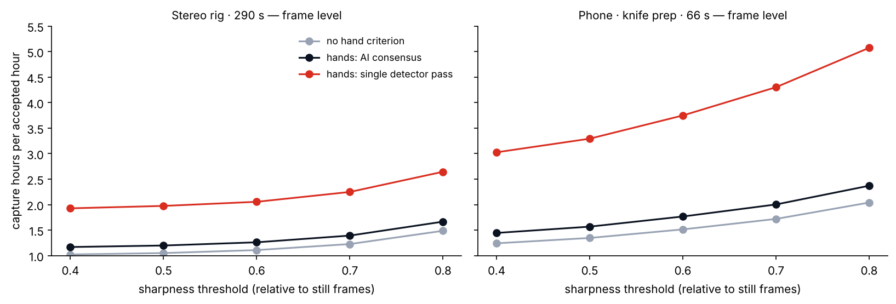
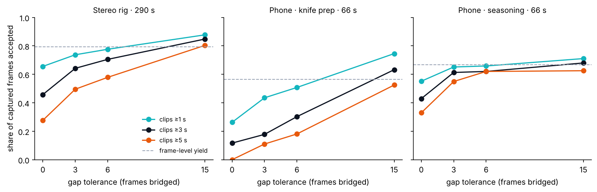
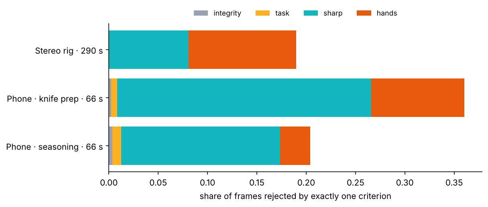
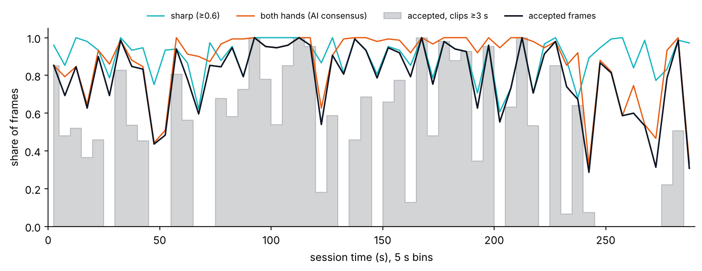
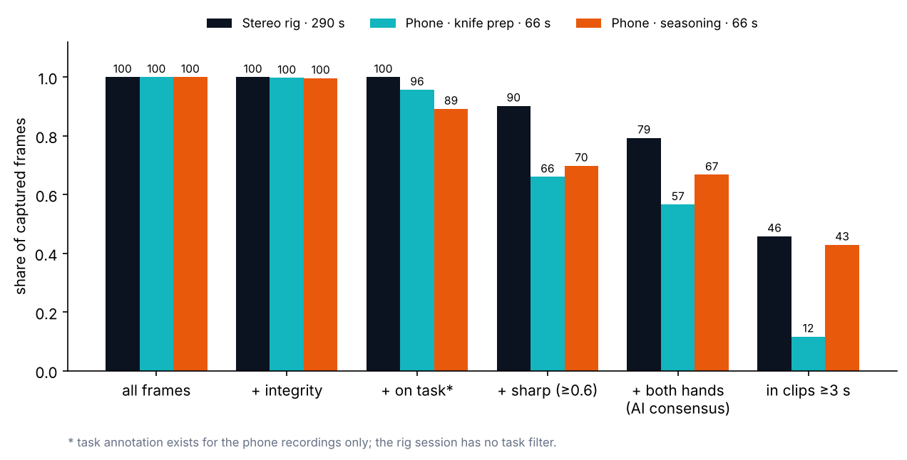

<!-- ODL_QUALITY_V2 -->

# Origin Data Lab · Technical Field Note #08

**Egocentric Footage Yield: Acceptance Layers**

[](https://github.com/origin-data-lab/usable-footage-yield-egocentric-capture) [](https://huggingface.co/datasets/origin-data-lab/usable-footage-yield-egocentric-capture) [](https://www.kaggle.com/datasets/origindatalab/egocentric-footage-yield-acceptance-layers) [](https://origindatalab.io/technical-field-notes/usable-footage-yield-egocentric-capture.html)

[English technical note](https://origindatalab.io/technical-field-notes/usable-footage-yield-egocentric-capture.html) ? [??? ????](https://origindatalab.io/ko/technical-field-notes/usable-footage-yield-egocentric-capture.html)

---

# Usable-Footage Yield for Egocentric Robot-Learning Data

Code and per-frame acceptance layers for **Origin Data Lab Technical Field Note #08** — *How Much Egocentric Capture Is Usable?*

> **Status: AI-only preliminary for the both-hands layer.** Integrity, sharpness and yield arithmetic are measured; hand checks come from MediaPipe without human verification.

## Contents
| Path | Description |
|---|---|
| `data/yield_frames.csv` | 12,651 rows — one per frame — with integrity, task, sharpness and hand layers |
| `analysis/yield_analysis.py` | Frame yield, clip yield, gap tolerance, sensitivity, per-minute stability, single-cause rejections |
| `analysis/stereo_full_quality.py` | Upstream: integrity, blur and sharpness for the stereo session (needs the source recording) |
| `results/yield_results.json` | Output of `yield_analysis.py` |
| `methodology.md` | Definitions, rules, parameters, limitations |

## Key results
| Recording | Frames | Frame yield | Clips ≥1 s | Clips ≥3 s | Clips ≥5 s |
|---|---:|---:|---:|---:|---:|
| stereo_rig_full_session | 8,694 | 79.3% | 65.6% | 45.8% | 27.7% |
| phone_knife_prep | 1,979 | 56.6% | 26.3% | 11.7% | 0.0% |
| phone_seasoning | 1,978 | 66.7% | 55.2% | 42.9% | 33.0% |

## Reproduce
```bash
pip install numpy pandas
python analysis/yield_analysis.py data/yield_frames.csv out
# out/yield_results.json equals results/yield_results.json
```

## License
**Code:** MIT License (`LICENSE`), Origin Data Lab’s own analysis code.

**Data (per-frame table) and documentation:** CC BY 4.0 (`LICENSE-DATA-CC-BY-4.0.md`). The released tables contain derived numeric measurements and flags; source videos, images, raw sensor data and calibration files are not included.

## Citation
Origin Data Lab (2026). How Much Egocentric Capture Is Usable? Measuring Footage Yield for Robot-Learning Data. Technical Field Note #08. https://origindatalab.io/technical-field-notes/usable-footage-yield-egocentric-capture.html

## Visual evidence

Figures are taken from the released technical-note package. Interpret with the original methods and limitations.

### capture hours per accepted hour



### clip yield vs tolerance



### single cause rejections



### stereo session timeline



### yield funnel



---

## Explore Origin Data Lab

[](https://github.com/origin-data-lab/usable-footage-yield-egocentric-capture) [](https://huggingface.co/datasets/origin-data-lab/usable-footage-yield-egocentric-capture) [](https://www.kaggle.com/datasets/origindatalab/egocentric-footage-yield-acceptance-layers) [](https://origindatalab.io/technical-field-notes/usable-footage-yield-egocentric-capture.html)

[Official Website](https://origindatalab.io/) ? [Technical Field Notes](https://origindatalab.io/technical-field-notes/) ? [English Note](https://origindatalab.io/technical-field-notes/usable-footage-yield-egocentric-capture.html) ? [Korean Note](https://origindatalab.io/ko/technical-field-notes/usable-footage-yield-egocentric-capture.html)

[GitHub](https://github.com/origin-data-lab/usable-footage-yield-egocentric-capture) ? [Hugging Face](https://huggingface.co/datasets/origin-data-lab/usable-footage-yield-egocentric-capture) ? [Kaggle Dataset](https://www.kaggle.com/datasets/origindatalab/egocentric-footage-yield-acceptance-layers) ? [Kaggle Notebook](https://www.kaggle.com/code/origindatalab/usable-footage-yield-egocentric-capture)
